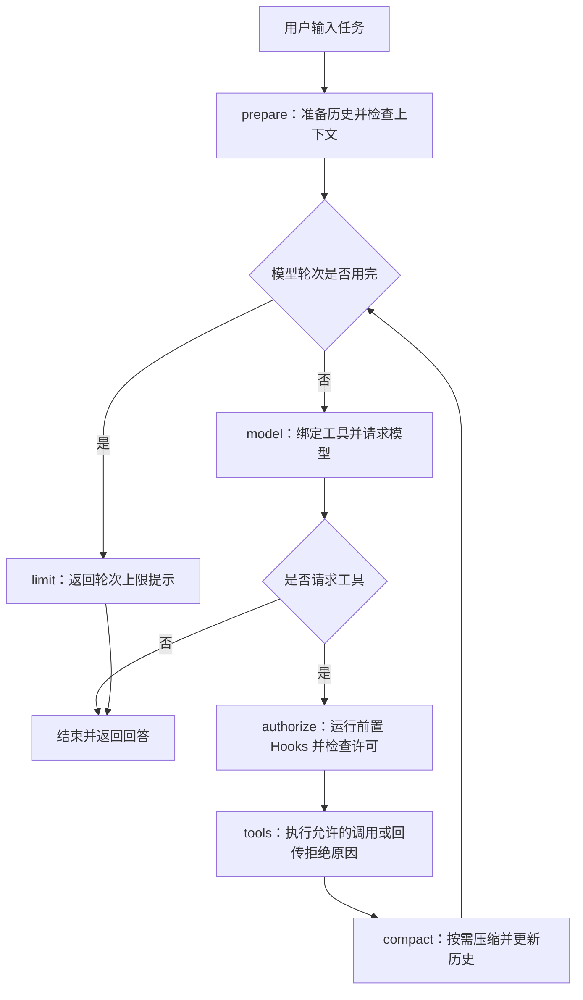

# AI 编程助手 · LangChain / LangGraph 实践版

一个在终端里运行的 AI Coding Agent。输入开发任务后，它可以查找代码、读取文件、提出修改、执行命令，再根据结果继续处理。当前本地接入阿里云百炼的 `qwen-flash`，也可以切换到其他支持工具调用的 OpenAI 兼容模型服务。

这个项目是我基于 [CoreCoder](https://github.com/he-yufeng/CoreCoder) 做的编程 Agent 复现与实践。我想通过一个能实际运行的项目，理解 Claude Code 这类工具如何把自然语言需求变成具体操作，以及用户应该在哪些环节介入。

本版本以 CoreCoder 0.8.0 为代码基础，在 0.9.0 中把执行核心迁移到 LangChain 和 LangGraph：模型请求经由 `ChatOpenAI`，工具包装为 `StructuredTool`，主循环由 `StateGraph` 调度。原有文件操作、权限、Hooks、上下文压缩、文件撤销、子 Agent 和 JSON 会话接口继续保留。

这次个人实践包括框架迁移、Qwen 接入、工具适配、关键回归验证和 Mac 启动入口。下文分别说明已经实现的部分、验证记录和后续计划。

## 1. 这个项目解决什么问题

开发过程中，一个简单的修复任务往往也要经历查文件、理解逻辑、修改代码、运行测试、查看报错等步骤。这个助手把这些操作放进同一段对话里，模型根据工具返回的结果决定下一步。

主要使用场景：

| 场景 | 可以交给助手的任务 | 需要检查的结果 |
| --- | --- | --- |
| 理解代码 | 找到入口，说明模块职责，定位某个函数 | 解释是否对应真实文件和代码 |
| 修复问题 | 根据报错定位代码，提出并执行修改 | 修改内容、测试输出和剩余问题 |
| 小范围开发 | 为已有功能补错误处理或测试 | 改动范围是否符合需求，测试是否通过 |

我把它作为学习 Agent 和验证产品想法的本地原型。项目通过 API 使用已有模型，不涉及预训练或微调大模型。

## 2. 当前版本与本地实践

| 项目 | 当前情况 |
| --- | --- |
| 代码基础 | CoreCoder 0.8.0，保留原作者 MIT 许可 |
| 当前版本 | 0.9.0，LangChain / LangGraph 迁移版 |
| 模型与工具层 | LangChain `ChatOpenAI`、`StructuredTool` |
| 执行流程 | LangGraph `StateGraph`，六个执行节点 |
| 使用方式 | 命令行交互、一次性任务、Python 库调用 |
| 本地模型 | 阿里云百炼 `qwen-flash` |
| 模型接口 | OpenAI Chat Completions 兼容接口 |
| 本地环境 | macOS，Python 3.13，项目独立 `.venv` |
| 配置方式 | 项目根目录 `.env`，密钥不写入源码和文档 |
| 启动入口 | `启动 CoreCoder.command` 或 `corecoder` 命令 |

本次迁移已经完成：

- 将原生 Python 主循环改为 LangGraph 图，保留 `Agent.chat()`、消息历史和 CLI 的使用方式。
- 使用 LangChain 绑定工具和接收模型流式响应，并兼容现有 Qwen 配置。
- 将内置工具和 MCP 动态工具包装为 `StructuredTool`，实际通过 `.invoke()` 执行。
- 在图中保留计划模式、操作授权、Hooks、文件快照和上下文压缩，补充迁移回归测试。
- 保留双击启动入口，并同步更新运行说明、架构讲解和实现边界。

迁移后的真实 Qwen 调用和固定文本工具链已经跑通；自动化测试与验证范围见第 9 节。

## 3. 启动与模型配置

### 已配置好的这台电脑

打开项目根目录，双击 `启动 CoreCoder.command`。首次在新电脑运行时，先完成下方的依赖安装与 `.env` 配置。

启动项会进入 CoreCoder 项目，使用 `.venv` 中的 Python，再由程序加载 `.env`。出现 `You >` 后即可输入任务。输入 `quit` 退出，`Ctrl + C` 取消当前任务。

也可以在终端启动：

```bash
cd corecoder-qwen
source .venv/bin/activate
corecoder
```

启动脚本按自身所在目录定位项目，使用该目录下的 `.venv` 和 `.env`。

### 在新环境中安装

要求 Python 3.10 及以上。先克隆本仓库并进入项目目录：

```bash
git clone https://github.com/Yuzhu-Ran/corecoder-qwen.git
cd corecoder-qwen
```

然后安装独立运行环境：

```bash
python3 -m venv .venv
source .venv/bin/activate
python -m pip install -e .
```

已经安装过 0.8.0 的环境也需要再执行一次 `python -m pip install -e .`，以安装新增的 LangChain、LangGraph 依赖并更新版本信息。

运行测试或离线测试演示时，额外安装开发依赖：

```bash
python -m pip install -e ".[dev]"
```

以上激活命令适用于 macOS / Linux。Windows 的虚拟环境激活方式不同，Shell 工具还需要可用的 POSIX Shell；具体选择见 [shell.py](corecoder/shell.py)。

### 配置 Qwen

在项目根目录新建 `.env`，与 `pyproject.toml` 放在同一层。Mac Finder 默认隐藏点开头的文件，可按 `Command + Shift + .` 显示。

```dotenv
CORECODER_PROVIDER=langchain
CORECODER_MODEL=qwen-flash
CORECODER_API_KEY=your-api-key
OPENAI_BASE_URL=https://dashscope.aliyuncs.com/compatible-mode/v1
```

将 `your-api-key` 换成自己在百炼申请的密钥。接口地址应与密钥所属地域匹配；其他地域按百炼文档配置。真实密钥只保存在本地 `.env`，不要放进 README 或提交到公开仓库。

配置由 [config.py](corecoder/config.py) 读取：

| 配置项 | 作用 |
| --- | --- |
| `CORECODER_PROVIDER` | 模型适配后端，默认 `langchain`；兼容值见下表 |
| `CORECODER_MODEL` | 模型名称，当前为 `qwen-flash` |
| `CORECODER_API_KEY` | 模型服务密钥；也兼容读取 `OPENAI_API_KEY`、`DEEPSEEK_API_KEY` |
| `OPENAI_BASE_URL` | OpenAI 兼容接口地址；也支持 `CORECODER_BASE_URL` |
| `CORECODER_MAX_TOKENS` | 单次请求的输出上限，默认 4096 |
| `CORECODER_MAX_CONTEXT` | 上下文压缩使用的窗口配置，默认 128000 |

`DASHSCOPE_API_KEY` 和 `QWEN_MODEL` 不是当前程序直接读取的变量名，需要按上表填写。默认由 LangChain 的 `ChatOpenAI` 使用兼容接口请求模型，实际网络地址仍为 `.env` 中配置的百炼地址。

| `CORECODER_PROVIDER` | 使用方式 |
| --- | --- |
| `langchain` | 默认路径，使用 `LangChainLLM` / `ChatOpenAI` |
| `openai` | 保留的兼容别名，也使用 LangChain 默认路径 |
| `legacy` | 使用原来的 `LLM`，保留直接 OpenAI 兼容 SDK 调用方式 |
| `litellm` | 使用原有可选 LiteLLM 后端，需安装 `corecoder[litellm]` |

以上选项切换的是模型适配后端。Agent 主流程仍由 LangGraph 调度，文件工具仍经 LangChain 工具适配执行。

对于同名变量，终端中已存在的值优先于 `.env`；命令行参数可以覆盖最后读取的配置。如果修改 `.env` 后没有生效，先检查终端里是否还保留了同名变量，再退出并重新启动。代码中的原始模型默认值仍为 `gpt-5.5`，本地通过 `.env` 覆盖。

## 4. 一个任务是怎么执行的



例如，“给一个函数补上异常处理并运行测试”可能按下面的顺序完成：

1. 模型调用 `glob` 或 `grep` 查找相关文件，再用 `read_file` 读取代码。
2. 模型提出 `edit_file` 调用，程序先运行前置 Hook，并检查计划模式和操作许可。
3. 允许修改后，工具检查待替换原文是否唯一，记录文件快照，写入修改并返回差异。
4. 模型请求通过 `bash` 运行测试，程序返回输出、错误和退出状态。
5. 模型根据测试结果继续处理，或者结束本轮任务并给出说明。

这是能力示例，不代表每次任务都会按相同顺序执行。下一步操作由模型决定，程序负责执行和回传结果。“先读再改”“改后验证”写在系统提示词中，当前没有单独的状态机强制检查每一步都完成。模型给出最终回答，也不等于测试一定通过，仍需查看实际工具结果。

## 5. 核心模块与技术实现

### LangGraph 执行图

[agent.py](corecoder/agent.py) 中的 `Agent.graph` 是编译后的 `StateGraph`。`Agent.chat()` 负责接收任务，再调用图执行；外部仍可通过 `agent.messages` 访问 OpenAI 格式的字典消息，原有 CLI、JSON 存档与上下文压缩接口可继续使用。

图中定义了六个节点：

| 节点 | 职责 |
| --- | --- |
| `prepare` | 接入当前消息历史，先检查是否需要压缩 |
| `model` | 组织系统提示词、调用模型，记录响应和模型轮次 |
| `authorize` | 展示调用信息，依次处理前置 Hook、计划模式和权限 |
| `tools` | 执行获准工具，或把拒绝原因作为工具结果回传 |
| `compact` | 在工具结果写回后检查上下文长度 |
| `limit` | 达到本轮模型调用预算后返回提示 |

主 Agent 默认最多执行 50 次模型节点，图的递归上限按节点数量调整，避免把“50 轮模型调用”误当作“50 次图节点执行”。上下文生成摘要时可能另有模型请求。

Bash 跟踪的工作目录会显式写入图状态，在图节点与工具线程之间传递，使前一轮的 `cd` 能影响后续 Bash 调用。工具异常通常转换为文本结果；`Ctrl + C` 中断时，会补齐未完成的工具回复，维持后续消息格式有效。

模型同一轮返回多个调用时，工具执行仍使用最多 8 个线程。当前是在本轮模型响应接收完成后批量执行，没有通用的任务依赖调度，也没有实现一边生成工具参数、一边开始执行的流式调度。

### LangChain 工具适配

[langchain_tools.py](corecoder/langchain_tools.py) 将原工具包装为 `StructuredTool`，保留名称、描述和 JSON Schema。图中的工具节点实际调用适配对象的 `.invoke()`，再由它调用原来的 `execute()`；文件读写等具体业务逻辑没有重复实现。

适配层使用 Python 签名检查缺失或多余参数，不对完整 JSON Schema 另加运行时类型校验，也不自动转换参数类型。MCP 工具的动态字段会原样传递给服务，由工具实现或远端完成具体语义校验。权限和 Hooks 仍由工具节点外层的调度逻辑控制。

### 八个内置工具

| 工具 | 功能 | 主要实现 |
| --- | --- | --- |
| `read_file` | 按行读取文本文件 | [read.py](corecoder/tools/read.py) |
| `glob` | 按文件名和路径模式查找 | [glob_tool.py](corecoder/tools/glob_tool.py) |
| `grep` | 正则搜索文件内容 | [grep.py](corecoder/tools/grep.py) |
| `write_file` | 新建或完整覆盖文件 | [write.py](corecoder/tools/write.py) |
| `edit_file` | 唯一原文匹配后替换，返回差异 | [edit.py](corecoder/tools/edit.py) |
| `bash` | 执行 Shell 命令，捕获输出和错误 | [bash.py](corecoder/tools/bash.py) |
| `todo_write` | 维护任务清单，并在后续请求中展示 | [todo.py](corecoder/tools/todo.py) |
| `agent` | 运行子 Agent 并返回结果 | [agent.py](corecoder/tools/agent.py) |

工具在 [tools/__init__.py](corecoder/tools/__init__.py) 中统一注册，再交给 LangChain 适配层。读取和搜索都有输出或扫描上限，大型仓库的结果可能不完整。

### 模型接入

[langchain_llm.py](corecoder/langchain_llm.py) 提供默认的 `LangChainLLM`。有工具时，通过 `ChatOpenAI.bind_tools()` 绑定定义，再通过 `.stream()` 接收响应，将文本、工具调用和 usage 转回项目原有的 `LLMResponse` 接口。

这一层保留流式输出、Token 统计和有上限的异常重试：最多两次瞬时错误重试，另有最多三次参数兼容调整，最坏共六次请求。共享模型对象的客户端缓存与 Token 更新使用锁保护，网络请求仍可并行。CLI 的 `/model` 或恢复会话修改模型名称后，下一次请求会按新配置创建或复用合适的客户端。

[llm.py](corecoder/llm.py) 中原来的 `LLM` 和 `LiteLLM` 保留为兼容路径，同时提供响应类型和费用统计。第三方接口的非标准思考字段是否可显示，取决于 LangChain 是否保留这些字段；有特定接口方言需求时，可以选择 `legacy` 路径。

### 上下文管理

[context.py](corecoder/context.py) 根据消息内容粗略估算 Token 用量，再按配置窗口分层处理：

| 触发位置 | 处理方式 |
| --- | --- |
| 超过约 50% | 缩短冗长的工具输出 |
| 超过约 70% | 总结较早的历史，保留近期消息 |
| 超过约 90% | 进一步压缩，只保留摘要和较少的近期消息 |

切分历史时会尽量保留工具调用和回复的配对关系。摘要失败时，退回到提取文件路径、错误信息等内容。压缩可能丢失信息，长任务中仍应保留清晰的目标和验收条件。

### Sub-agent

子 Agent 使用同一套 LangGraph Agent 实现，有自己的执行图和对话历史，复用父 Agent 的模型对象、工具实例、权限和 Hooks，默认最多 20 轮。它不再拥有 `agent` 工具，因此不能继续递归派生。

子 Agent 同步执行完后返回文本；过长结果会截短。独立的是对话历史，文件系统和部分工具状态仍然共享，没有自动创建容器或独立代码副本。

当前仍是主 Agent 分派子任务的基础结构，没有新增研究、编码、评审等角色的复杂图编排。

### MCP 扩展

[mcp.py](corecoder/mcp.py) 从 `~/.corecoder/mcp.json` 加载服务配置，通过 stdio 启动子进程并进行 JSON-RPC 通信。外部工具注册为 `mcp__服务器__工具`，与内置工具一起交给模型调用，也受权限和 Hooks 控制。

当前实现面向 MCP `2025-06-18` 版本的工具接口，包含初始化、`tools/list` 和 `tools/call`。没有接入 MCP 的 HTTP 传输、resources 或 prompts。服务状态可用 `/mcp` 查看，失效服务可手动重连。

配置和使用示例见 [MCP 文件系统示例](examples/mcp_filesystem.md)。本地版本具备该实现，但本次没有连接外部 MCP 服务进行端到端验证。

## 6. 从产品使用角度看这些机制

这次实践中，我主要关注任务过程是否看得懂、是否方便介入，以及执行出错后能否恢复。

| 使用中的问题 | 项目已有机制 | 实际边界 |
| --- | --- | --- |
| 用户想先看方案再动手 | Plan Mode，限制为只读调查，批准后再执行 | 计划依赖模型生成，没有独立的计划管理界面 |
| 不清楚模型接下来会做什么 | 展示工具名和参数，修改类调用请求授权 | 授权粒度主要按工具，不是细化到每个文件或命令前缀 |
| 文件改错后需要恢复 | 写入前保存快照，`/undo` 恢复最近一次修改 | 只覆盖 `write_file`、`edit_file`，不追踪 Bash 的副作用 |
| 任务较长，历史占满窗口 | 分层上下文压缩，必要时生成摘要 | Token 是估算值，摘要可能遗漏细节 |
| 中断后需要继续讨论 | `/save` 保存消息和模型名，`-r` 恢复 | 不会完整恢复终端进程、工具内存等运行现场 |
| 想知道调用消耗 | `/tokens` 查看 Token 用量，已知价格时估算费用 | `qwen-flash` 需另补价格配置，当前没有费用硬预算 |

这些机制是我理解 AI 产品可控性的具体切入点：哪些步骤可以交给模型，哪些动作需要用户确认，结果用什么依据判断。这次记录集中在现有实现与本地体验，后续评估方案见第 9 节。

### 计划模式与授权

输入 `/plan` 后，只读工具仍可用，修改文件、Bash、MCP 和子 Agent 等调用会被拒绝，即使启动时使用 `--yes` 也一样。模型收到拒绝原因后，可以继续调查并给出计划。

输入 `approve` 会退出计划模式并把批准消息交给模型。再次输入 `/plan` 只切换模式，不会自动开始执行计划。

普通交互模式下，`read_file`、`glob`、`grep` 和 `todo_write` 默认直接执行。其他工具可以允许一次、按工具持续允许，或拒绝。持续许可保存在 `~/.corecoder/permissions.json`。

直接作为 Python 库创建 `Agent(...)` 时，默认没有配置权限层；嵌入自己的程序时，需要显式传入合适的 `Permission`。

这次迁移保留了上述原有交互，没有接入 LangGraph `interrupt`。审批回调仍在当前运行中完成，不支持把挂起的审批状态保存后跨进程继续执行。

### Token 与费用

`/tokens` 可查看累计输入和输出 Token。费用估算依赖价格表，`qwen-flash` 当前不在内置表中，因此本地默认不会显示它的费用估算。

如需估算，在 `~/.corecoder/pricing.json` 中补充 `qwen-flash` 条目，值为 `[每百万输入 Token 的美元价格, 每百万输出 Token 的美元价格]`。具体数字按实际服务价格填写。估算不能替代平台账单，也不会自动限制消费。

## 7. 常用操作

| 操作 | 作用 |
| --- | --- |
| `/help` | 查看帮助 |
| `/plan` | 开关计划模式 |
| `approve` | 批准计划并交回模型处理 |
| `/model <名称>` | 在当前会话切换模型；不会同步切换接口地址 |
| `/tokens` | 查看累计 Token；价格已知时显示费用估算 |
| `/compact` | 检查是否需要按阈值压缩上下文，并非强制摘要 |
| `/diff` | 列出本次运行记录的已修改文件；完整差异见单次编辑结果 |
| `/undo` | 撤销最近一次由文件写入工具记录的改动 |
| `/save` | 保存当前对话，返回会话 ID |
| `/sessions` | 列出已保存会话 |
| `/reset` | 清空当前对话和任务清单 |
| `/mcp` | 查看 MCP 服务状态 |
| `/mcp reconnect <名称>` | 重连指定服务 |
| `quit` / `exit` | 退出程序 |

恢复已保存会话：

```bash
corecoder -r <会话ID>
```

恢复会话时，程序默认使用存档中的模型名称，会覆盖 `.env` 的模型设置。若要继续使用当前 Qwen 配置，可显式指定：

```bash
corecoder -r <会话ID> -m qwen-flash
```

当前保存的仍是 JSON 对话存档。图尚未配置持久化 checkpointer，恢复存档不等于恢复上一进程中某个挂起的图节点。文件撤销依旧由 `checkpoints.py` 的文件快照负责，与 LangGraph 图检查点是不同机制。

一次性执行任务：

```bash
corecoder -p "解释当前目录的项目结构"
```

一次性模式默认拒绝修改类工具。如果确实需要预先允许所有工具，可使用 `--yes`：

```bash
corecoder --yes -p "为示例函数补充测试并运行"
```

Hooks 配置保存在 `~/.corecoder/hooks.json`。PreToolUse 可用退出码 2 否决调用，PostToolUse 观察执行结果；超时或错误通常记录警告后跳过。该机制没有默认提供格式化、审计平台或业务规则，需要自行配置。

## 8. 项目目录与技术栈

```text
corecoder-qwen/
├── corecoder/
│   ├── cli.py             命令行入口与交互命令
│   ├── agent.py           LangGraph 状态图与工具调度
│   ├── langchain_llm.py   ChatOpenAI 模型绑定、流式响应与兼容适配
│   ├── langchain_tools.py StructuredTool 桥接
│   ├── llm.py             响应类型、费用统计与旧模型适配兼容路径
│   ├── config.py          .env 与环境变量配置
│   ├── context.py         上下文压缩
│   ├── prompt.py          系统提示词
│   ├── permissions.py     工具许可
│   ├── session.py         会话保存与恢复
│   ├── checkpoints.py     文件快照与撤销
│   ├── hooks.py           工具调用前后钩子
│   ├── mcp.py             MCP stdio 客户端
│   ├── shell.py           Shell 选择与执行
│   ├── demo.py            离线脚本演示
│   └── tools/             八个内置工具及工具基类
├── tests/                 自动化测试
├── examples/              计划模式、Hooks 与 MCP 示例
├── article/               上游作者的源码导读
├── assets/                上游演示素材
├── .env                   本地模型配置，不公开密钥
├── 启动 CoreCoder.command  Mac 启动入口
├── pyproject.toml         依赖、版本和打包配置
├── README.md              当前中文项目说明
├── README_CN.md           与主文档同步的中文说明
└── LICENSE                原始 MIT 许可证
```

主要依赖：Python、LangChain、LangGraph、`langchain-openai`、`openai`、`rich`、`prompt_toolkit`、`python-dotenv`。当前约束使用 LangChain / LangGraph 1.x 系列。开发工具为 pytest 和 Ruff，打包使用 Hatchling。LiteLLM 为可选依赖。

## 9. 验证情况与后续评估

### 已完成的本地验证

以下为截至 2026-11-02 的实际验证记录。测试环境为 Python 3.13，LangChain 1.4.7、langchain-openai 1.7.3、LangGraph 1.2.19：

| 检查项 | 结果 |
| --- | --- |
| LangChain 模型适配 | 离线测试已通过，覆盖流式消息、工具调用、usage 与模型切换 |
| StructuredTool 适配 | 离线测试已通过，覆盖签名错误、默认参数、状态和 MCP 动态字段 |
| LangGraph 主流程 | 离线测试已通过，覆盖节点路由、轮次预算、权限拒绝与调用反馈 |
| 原有能力回归 | 已通过原有工具、权限、Hooks、上下文和会话等回归检查 |
| 完整自动化测试 | `276 passed, 1 skipped`；跳过的是需显式开启的联网测试 |
| 代码检查 | Ruff 通过 |
| 临时示例文件任务 | 经真实执行图完成写入、读取、修改，并用 Python 运行断言通过；模型响应使用离线脚本 |
| 原版 Qwen 联网验证 | 迁移前已返回 HTTP 200，并跑通固定文本工具调用 |
| 迁移后 Qwen 联网验证 | 已通过：真实 `qwen-flash` 请求经 `ChatOpenAI`、`StateGraph` 和 `StructuredTool` 完成工具调用并返回回答 |
| Qwen 只读联网任务 | 另行开启的联网测试 `1 passed`：通过受限 `read_file` 读取临时生成的测试文本并正确回答 |

自动化回归使用模拟模型和隔离目录，不需要在测试中填写真实 API Key。离线通过说明接口和控制流程符合测试预期；不同模型实际修复代码的表现、外部 MCP 服务和长任务稳定性仍需另外验证。真实 Qwen 验证只使用固定文本工具和临时生成的测试文本，没有读取或发送本地项目源码；它验证模型与框架协作，不代表已经测得真实代码修复成功率。

仓库保留测试和 CI 配置。上游自动发布 PyPI 包的工作流未包含在此展示版本中；当前仓库用于源码展示与本地运行。要在自己的环境中运行：

```bash
python -m pip install -e ".[dev]"
python -m pytest tests/ -v
python -m ruff check corecoder tests
```

离线演示入口：

```bash
corecoder --demo
```

演示使用脚本预设的模型响应，适合观察 Agent 的执行顺序；不能用来证明真实模型的任务成功率。

### 下一步怎样评估

我计划使用固定的示例任务记录实际表现，先从解释入口、修复小函数、补充测试三类任务开始。

| 指标 | 记录方法 |
| --- | --- |
| 任务完成情况 | 检查交付文件和测试结果，记录完成、失败及原因 |
| 人工介入次数 | 记录补充需求、纠正方向和手动修复的次数 |
| 执行耗时 | 记录从发出任务到结果可检查的时间 |
| Token 与费用 | 记录任务消耗；补齐价格后估算费用，并与平台账单核对 |
| 可恢复性 | 检查拒绝授权、工具报错或中断后能否继续，以及文件撤销是否符合预期 |

这些是后续验证方案，目前没有填写完成率或效率提升数字。

## 10. 使用边界与改进方向

- **执行隔离**：Bash 的危险命令检测依赖正则规则，当前没有容器级或系统调用级沙箱。
- **代码外发**：模型通过外部 API 工作；工具读取的代码可能进入后续模型请求，应在允许向该服务发送内容的项目中使用。
- **回滚范围**：快照只追踪两个文件写入工具；Bash、外部 MCP 工具和其他进程造成的改动不在同一撤销范围内。
- **任务规模**：文件搜索有扫描上限，未实现 RAG 或专门的大仓库代码索引。
- **长任务与调度**：上下文压缩、同步子 Agent 和批量并行执行仍有局限，没有完整的任务依赖编排。
- **图持久化**：已使用 LangGraph 执行流程，但没有配置图 checkpointer、`interrupt` 恢复或跨进程审批；当前会话保存仍走原有 JSON 接口。一个 Agent 实例用于一段顺序对话，不支持并发调用同一实例的 `chat()`。
- **费用与故障处理**：没有金额硬预算和模型自动回退链，费用统计也依赖服务返回的 usage 与价格配置。

后续优先补齐真实模型的固定任务验证，再根据失败原因选择改进点。需要跨进程恢复时，再接入持久化 checkpointer 与人工中断；需要更细的任务分工时，再设计多角色子图。框架提供这些能力，不代表本版本已经接入。

## 11. 参考资料与来源

| 资料 | 与本项目的关系 |
| --- | --- |
| [CoreCoder · he-yufeng](https://github.com/he-yufeng/CoreCoder) | 直接的代码基础，提供 Agent、工具、会话和扩展机制 |
| [CoreCoder 原始 README](https://github.com/he-yufeng/CoreCoder/blob/main/README_CN.md) | 原项目定位、功能说明和运行方式；本文结合本地情况重写 |
| [CoreCoder 源码导读](article/00-index.md) | 上游作者对循环、工具、模型接入、上下文和扩展的解释 |
| [上游作者的 Claude Code 源码分析](article/claude-code-source-analysis.md) | CoreCoder 架构参考的背景材料；文中的源码来源与经历由原作者陈述 |
| [Claude Code 官方介绍](https://code.claude.com/docs/en/overview) | 了解编程 Agent 的产品使用方式与功能概念 |
| [MCP 官方架构文档](https://modelcontextprotocol.io/docs/learn/architecture) | 理解 Host、Client、Server 和工具通信；具体支持范围以本项目实现为准 |
| [阿里云百炼 OpenAI 兼容接口](https://help.aliyun.com/zh/model-studio/compatibility-of-openai-with-dashscope) | 核对 Qwen 的模型接入方式、接口地址和密钥配置 |
| [LangGraph Quickstart](https://docs.langchain.com/oss/python/langgraph/quickstart) | 参考模型节点、工具节点、条件边和状态图的组织方式 |
| [LangChain ChatOpenAI](https://docs.langchain.com/oss/python/integrations/chat/openai) | 参考工具绑定、消息流和模型接口适配 |
| [LangGraph Persistence](https://docs.langchain.com/oss/python/langgraph/persistence) | 后续图持久化方案的参考；当前版本尚未接入 checkpointer |
| [nanoGPT · Karpathy](https://github.com/karpathy/nanoGPT) | 上游 README 对“少量、可读、可修改的核心实现”的定位类比，不是本项目运行依赖 |

上游作者在源码分析文章中称，其研究对象包括泄露的 Claude Code 源码。这份分析属于上游参考资料，本版本以开源的 CoreCoder 源码为直接基础。

`article/` 中的导读针对上游实现，属于保留的历史学习资料。迁移后 `agent.py` 和模型适配已发生变化，文章中的行数与代码片段可能不再对应当前版本，具体行为以当前源码和测试为准。

## 12. 开源许可

保留 CoreCoder 的 [MIT 许可证](LICENSE) 和原作者 `Yufeng He` 的版权声明。`article/` 中的文章、上游演示素材及其署名保持原样。本 README 是个人实践版说明，项目名称和文档调整不改变原始代码的来源。
